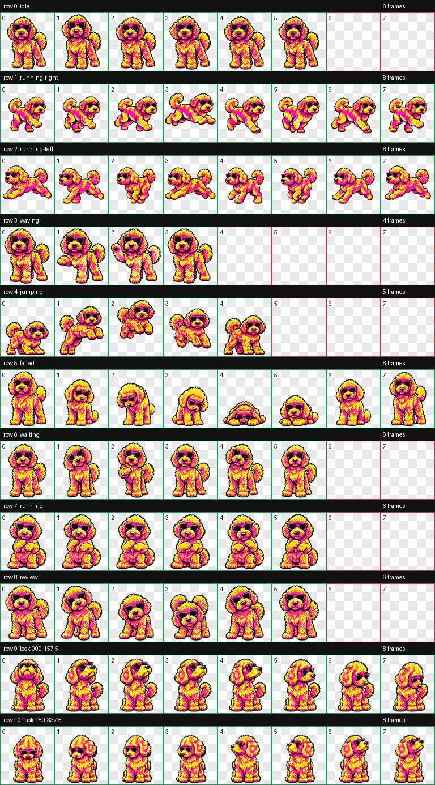

# Yoshi

Yoshi is a custom animated ChatGPT Work pet: a neon pink-and-yellow Goldendoodle in hot-pink sunglasses.

## Contents

- `assets/yoshi-spritesheet-v2.png` — transparent v2 sprite sheet (`1536 × 2288`), with nine animation states and sixteen look directions.
- `qa/contact-sheet.png` — visual overview of the animation frames.
- `qa/validation.json` — structural validation report.
- `qa/quality.json` — final quality-gate report.
- `qa/direction-semantics.json` — look-direction review notes.

## Validation

The included v2 PNG passed structural validation and the final quality gate. The quality report retains five look-loop continuity warnings; the structural report contains no errors or warnings. Both reports include the sprite sheet's SHA-256 hash for verification.

The report paths are relative to this repository. The contact sheet is rendered from the included sprite sheet.

## Attribution

The sprite artwork was generated from a supplied neon Goldendoodle illustration. The original reference image is not included.
